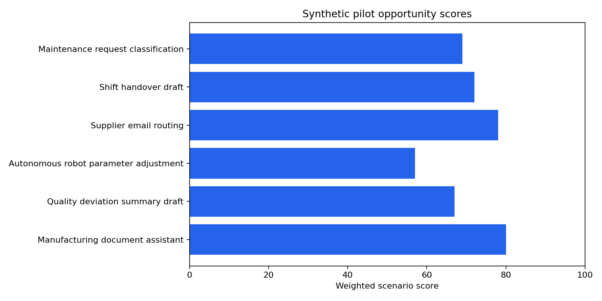

# Manufacturing AI Pilot Decision Study

**Author:** Mohammed Adeen Shaik  
**Review date:** 11 October 2026

## Research question

How do assumed value, eligibility gates and pilot evidence affect six fictional opportunity decisions?

## Data and provenance

Six developer-authored synthetic proposals in data/opportunities.json.

Source materials are linked from the repository README. Input fingerprints are recorded in [the evidence manifest](evidence.json) so a reader can identify the exact committed artifacts used in this review.

## Method and analytical rationale

evaluate.py applies the implemented deterministic scoring and assessment rules without changing the application database. Benefit calculations use 48 working weeks and assumed adoption.

## Findings and interpretation

Fresh deterministic evaluation on 11 October 2026: **4/6 fictional proposals** meet the configured pilot gates. Scenario benefit values use assumed adoption, 48 working weeks and an assumed hourly value of released capacity. They are **not observed savings**.

| name | pilot_eligible | base_net_annual_benefit |
|---|---|---|
| Manufacturing document assistant | True | see JSON |
| Quality deviation summary draft | True | see JSON |
| Autonomous robot parameter adjustment | False | see JSON |
| Supplier email routing | True | see JSON |
| Shift handover draft | False | see JSON |
| Maintenance request classification | True | see JSON |

## Limitations

Released capacity is not observed cash savings. Scores are policy choices and do not prove a proposal will succeed. Synthetic approvals and role simulation are not enterprise authorization.

## Reproduction

Use the setup commands and input contract in the [repository README](https://github.com/Adeen1607/ai-opportunity-pilot-tracker#readme). Open the [notebook catalogue](notebooks.html) for annotated code and saved outputs. Keep raw records and model binaries local; public reports contain aggregate results or source-embedded figures.

## Final visual results

*Reproduced aggregate figure: scenario-scores.png.*

